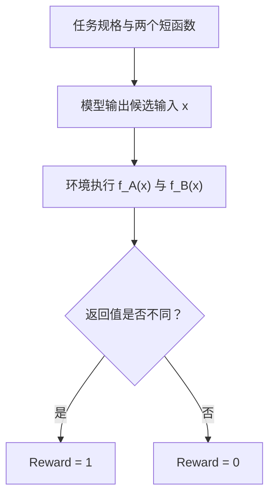

# nano-GRPO

轻量、可复现的可验证奖励强化学习（RLVR）练手项目：用 Qwen2.5-1.5B 和 GRPO 学习程序差分测试与反例挖掘。

[](./LICENSE)
[](https://www.python.org/)
[](https://pytorch.org/)
[](https://huggingface.co/Qwen/Qwen2.5-1.5B)
[](#hardware)

模型读取两个短函数，输出使它们结果不同的输入；奖励由程序执行验证。主线实验使用 60 道训练题、20 道验证题和 20 道测试题。三个训练种子下，测试集贪心成功率从基座的 **40.0%** 提升至 **78.33% ± 2.89%**（均值 ± 样本标准差）。

[实验结果](#results) · [快速开始](#quickstart) · [演示](#demo) · [任务与奖励](#tasks) · [算法](#algorithm) · [硬件](#hardware) · [目录结构](#structure)

<a id="results"></a>
## 实验结果

训练种子为 42、43、44，每次训练 15 个宏步、75 次参数更新。各次实验均按验证集分数选择 `checkpoint-best`，再在同一份 20 题测试集上评测。

### 模型结果

| 模型 / 训练种子 | 最佳宏步 | 贪心 Pass@1 | 采样 Pass@4 | 采样候选命中率 |
| --- | ---: | ---: | ---: | ---: |
| Qwen2.5-1.5B Base | — | 40.0%（8/20） | — | — |
| GRPO · Seed 42 | 12 | 80.0%（16/20） | 85.0%（17/20） | 76.25%（61/80） |
| GRPO · Seed 43 | 13 | 80.0%（16/20） | 85.0%（17/20） | 71.25%（57/80） |
| GRPO · Seed 44 | 15 | 75.0%（15/20） | 85.0%（17/20） | 77.50%（62/80） |
| **三次训练的均值 ± 标准差** | — | **78.33% ± 2.89%** | **85.00% ± 0.00%** | **75.00% ± 3.31%** |

- **贪心 Pass@1**：每题生成一个确定性回答，统计解决题数。
- **采样 Pass@4**：每题采样四个回答，至少一个成功即算该题解决；采样温度为 `0.7`。
- **采样候选命中率**：80 个采样回答中成功回答的比例。

完整记录：[多种子实验报告](./reports/multiseed_counterexample_report.json)。上表的 Base 采样指标未包含在该汇总报告中，因此留空。

### 非学习基线

| 方法 | 一次尝试成功率 | 四次尝试成功率 | 四次尝试的候选命中率 |
| --- | ---: | ---: | ---: |
| 随机探测 | 5.0%（1/20） | 15.0%（3/20） | 6.25%（5/80） |
| AST 常量优先启发式 | 65.0%（13/20） | 95.0%（19/20） | 27.50%（22/80） |

启发式从代码中提取常量并探测常量及邻域。它在四次尝试下优于当前模型；本项目展示的是 GRPO 相对于模型自身基线的学习提升。完整记录：[基线评测报告](./reports/counterexample_baselines_report.json)。

> 当前结果来自小型合成基准。三个训练种子的标准差描述本次实验的波动，不等同于大规模泛化结论或置信区间；测试题之间也可能共享程序模板。


*实线为均值，阴影为 ±1 个标准差。图中依次展示成功率、奖励组分布、损失与梯度、KL 与生成长度。*

<a id="quickstart"></a>
## 快速开始

### 1. 获取项目并安装依赖

```bash
git clone https://github.com/littlelei0103/nano-GRPO.git
cd nano-GRPO

conda create -n nano-grpo python=3.11 -y
conda activate nano-grpo
pip install -r requirements.txt
```

### 2. 运行测试

```bash
python -m unittest discover -s tests -v
```

测试覆盖损失计算、梯度累积、断点恢复、重采样和差分判题。

### 3. 训练主线任务

```bash
python train_mimo.py \
  --task counterexample \
  --global_steps 15 \
  --anchor_size 60 \
  --problems_per_update 12 \
  --group_size 4 \
  --micro_batch_size 2 \
  --max_new_tokens 32 \
  --lr 2e-5 \
  --seed 42
```

每个宏步覆盖全部 60 道训练题，打乱后每 12 题更新一次参数。检查点保存到 `checkpoints_counterexample/<run-id>/`；控制台会打印实际实验目录。

### 4. 恢复训练

将下面变量替换为控制台打印的实验目录。续训时保持原实验的任务、种子和关键超参一致。

```bash
TASK_RUN_DIR="checkpoints_counterexample/替换为实际run-id"
python train_mimo.py \
  --task counterexample \
  --resume_checkpoint "$TASK_RUN_DIR/checkpoint-last" \
  --global_steps 25 \
  --seed 42
```

`--resume_checkpoint` 恢复权重、优化器、训练进度和 RNG 状态；`--init_adapter` 仅以已有 LoRA 权重初始化新实验。数据或判题指纹改变后，旧实验不能按原状态精确续训。

### 5. 其他训练方式

```bash
# 流式训练：每题执行一次参数更新
python train.py --task counterexample --total_steps 100 --lr 2e-5

# 差分缺陷审计：输出输入参数，由环境计算正确结果
python train_mimo.py \
  --task bug_differential \
  --save_dir checkpoints_differential \
  --global_steps 15 \
  --problems_per_update 12 \
  --max_new_tokens 200

# 用 Counterexample 权重初始化差分任务的新实验
python train_mimo.py \
  --task bug_differential \
  --init_adapter "$TASK_RUN_DIR/checkpoint-best" \
  --save_dir checkpoints_transfer \
  --max_new_tokens 200
```

扩展任务的生成长度需要单独验证。Counterexample 的短输出配置与硬件测量不能直接套用到长代码审计任务。

<a id="demo"></a>
## 交互式演示

先完成训练，再运行：

```bash
python demo.py --num_cases 3

# 也可指定检查点
python demo.py --checkpoint "$TASK_RUN_DIR/checkpoint-best" --num_cases 3
```

演示并排展示程序对、Base 与训练后模型的输入，以及执行结果。例如：

```python
def f_a(x):
    return x < 38

def f_b(x):
    return x <= 38
```

输入 `39` 时两个程序都返回 `False`；输入 `38` 时返回值不同，成功找到反例。

<details>
<summary>展开查看完整终端输出样例</summary>

```text
========================================================================
nano-GRPO: Program Differential Testing & Counterexample Mining Demo
Base Model: Qwen/Qwen2.5-1.5B | Device: cuda
RLVR Checkpoint: checkpoints_counterexample/20261014T135458Z-022190f1/checkpoint-best
========================================================================
[Model Init] Loading base model and LoRA adapter weights...
[Model Setup] Loading base tokenizer and model: Qwen/Qwen2.5-1.5B...
[Model Setup] Resuming LoRA adapter weights from checkpoint: .../checkpoint-best
trainable params: 9,232,384 || all params: 1,552,946,688 || trainable%: 0.5945
  [Memory Snapshot Post-Model-Init] Allocated: 2980.5 MB | Reserved: 3192.0 MB (Capacity: 8151 MB)
[Model Init] Base policy and RL adapter ready.

────────────────────────────────────────────────────────────────────────
[Case 1] Problem ID: cmp_lt_lte_26 | Tier: level_1
Specification: Check if x is strictly less than 38 vs at most 38.
Domain: [0, 50] | Counterexamples: [38] (Sparsity: 1.96%)
────────────────────────────────────────────────────────────────────────
【Program Pair Specification】:
  def f_a(x: int) -> bool:           │  def f_b(x: int) -> bool:
      return x < 38                  │      return x <= 38
────────────────────────────────────────────────────────────────────────
  Zero-Shot Base Policy                 │  RLVR Optimized Policy
  Raw: '39</input>'                     │  Raw: '38</input>'
  Parsed Input: 39                      │  Parsed Input: 38
  f_A(39)             = False           │  f_A(38)             = False
  f_B(39)             = False           │  f_B(38)             = True
  Verification: Outputs Match (0.0)     │  Verification: Divergence Confirmed (+1.0)
────────────────────────────────────────────────────────────────────────
[Case 2] Problem ID: interval_right_open_30 | Tier: level_2
Specification: Interval inclusion: [33, 42] vs [33, 42).
Domain: [0, 50] | Counterexamples: [42] (Sparsity: 1.96%)
────────────────────────────────────────────────────────────────────────
【Program Pair Specification】:
  def f_a(x: int) -> bool:           │  def f_b(x: int) -> bool:
      return 33 <= x <= 42           │      return 33 <= x < 42
────────────────────────────────────────────────────────────────────────
  Zero-Shot Base Policy                 │  RLVR Optimized Policy
  Raw: '33</input>'                     │  Raw: '42</input>'
  Parsed Input: 33                      │  Parsed Input: 42
  f_A(33)             = True            │  f_A(42)             = True
  f_B(33)             = True            │  f_B(42)             = False
  Verification: Outputs Match (0.0)     │  Verification: Divergence Confirmed (+1.0)
────────────────────────────────────────────────────────────────────────
[Case 3] Problem ID: clamp_abs_min_clip_33 | Tier: level_2
Specification: Upper bound clamp using min(x, 25) vs min(x, 26).
Domain: [0, 50] | Counterexamples: [26, 27, 28, 29, 30, 31] (Sparsity: 49.02%)
────────────────────────────────────────────────────────────────────────
【Program Pair Specification】:
  def f_a(x: int) -> int:            │  def f_b(x: int) -> int:
      return min(x, 25)              │      return min(x, 26)
────────────────────────────────────────────────────────────────────────
  Zero-Shot Base Policy                 │  RLVR Optimized Policy
  Raw: '25</input>'                     │  Raw: '50</input>'
  Parsed Input: 25                      │  Parsed Input: 50
  f_A(25)             = 25              │  f_A(50)             = 25
  f_B(25)             = 25              │  f_B(50)             = 26
  Verification: Outputs Match (0.0)     │  Verification: Divergence Confirmed (+1.0)
========================================================================
```

</details>

<a id="tasks"></a>
## 任务与可验证奖励

### Counterexample：程序差分反例挖掘

给定程序对，模型输出使两个返回值不同的输入。生成器离线枚举输入域，确认反例存在并记录反例稀疏度。

| 难度 | 示例 |
| --- | --- |
| Level 1 | 比较运算符的边界差异，如 `<` 与 `<=` |
| Level 2 | 区间端点、裁剪与极值函数差异 |
| Level 3 | 周期取模与分段逻辑 |
| 可选 2D 扩展 | 二元输入、几何边界与分段条件 |



### 扩展任务

- **`bug_differential`**：阅读规格和缺陷代码，仅输出参数字面量；环境执行 Golden 与 Buggy 实现，检查输入是否合法、行为是否不同。
- **`bug_hunter`**：生成 `assert target_func(...) == expected`，同时验证正确结果与漏洞暴露能力。
- **`code_exec`**：生成函数代码，由受限执行器运行测试。执行器支持的 Python 子集见 [code_worker.py](./tasks/code_worker.py)。

`bug_differential` 通过带类型标记的 JSON 传输返回值。支持 `None`、布尔、整数、浮点、字符串、bytes，以及嵌套的 list、tuple、dict、set、frozenset。比较在所有层级区分类型、忽略字典与集合顺序；浮点使用相对和绝对容差 `1e-7`，NaN 与 NaN 视为等价，无穷值保留符号。自定义对象和超过 64 层的容器不在返回值契约内，序列化失败不获得差分奖励。

### 实验性动态重采样

宏步引擎支持 `--dynamic_resampling`。初始组全错时，在限定次数内追加探索，尝试获得有奖励差异的组。重采样强制与原策略同温，`--resample_temp_boost` 仅接受兼容值 `0.0`。

| 日志指标 | 统计范围 |
| --- | --- |
| `initial_pass_rate` | 初次采样 |
| `anchor_pass_rate` | 最终保留组 |
| `overall_rollout_pass_rate` | 包含重采样的全部尝试 |
| `total_tokens_generated` | 全部生成的有效补全 token，含 EOS、不含 padding |
| `retained_tokens_generated` | 最终用于更新的样本 token |

成功筛选会改变训练样本分布。比较重采样效率时，采用全部尝试的候选数与 token 预算。

<a id="algorithm"></a>
## 算法与更新方式

### 组相对优势

每题采样 G 个候选，计算组内标准化优势。当前实现使用 PyTorch 的样本标准差：

$$
A_i = \frac{R_i - \mu_R}{s_R + \epsilon}, \qquad
\mu_R = \frac{1}{G}\sum_{j=1}^{G}R_j, \qquad
s_R = \sqrt{\frac{1}{G-1}\sum_{j=1}^{G}(R_j-\mu_R)^2}
$$

全对或全错的组没有奖励优势信号。开启 KL 时，这些组仍可贡献参考策略正则项；KL 为零时跳过其反传。

### 基座参考 KL 正则

通过 PEFT 的 `disable_adapter()` 获取基座参考概率，复用模型权重。采样、当前策略和参考策略的 logprob 使用相同温度。代码中的 k3 项为：

$$
\Delta_t = \log \pi_{\mathrm{ref}}(y_t \mid x,y_{<t})
           - \log \pi_\theta(y_t \mid x,y_{<t})
$$

$$
k_{3,t} = \exp(\Delta_t) - 1 - \Delta_t
$$

实现使用 FP32 `expm1` 并将微小负舍入值截为零；没有额外除以温度平方。

### 子批次更新与微批次累积

每轮打乱训练池，将其切分为 `problems_per_update` 大小的题目批次。每题先按整组有效补全 token 数归一化，再按本次更新的题目数平均：

$$
\mathcal{L}_{\mathrm{update}}
= \frac{1}{M}\sum_{q=1}^{M}
  \frac{\sum_{i=1}^{G}\sum_t m_{q,i,t}\,\ell_{q,i,t}}
       {\sum_{i=1}^{G}\sum_t m_{q,i,t}+\epsilon}
$$

这里 M 是本次更新的题目数，m 是有效 token 掩码，ℓ 是 PPO-Clip 策略损失与 KL 正则之和。`micro_batch_size` 控制单次前向、反传的候选数，归一化分母仍覆盖整题的全部候选。

<a id="dataset"></a>
## 数据与评测划分

主线数据见 [counterexample_dataset.json](./tasks/data/counterexample_dataset.json)。

| 划分 | 规模 | 用途 |
| --- | ---: | --- |
| Train | 60 题 | 强化学习采样与更新 |
| Validation | 20 题 | 贪心评测，选择 `checkpoint-best` |
| Test | 20 题 | 训练结束后评测 Base、Best 与 Last |

训练不使用测试集选择检查点。合成程序对去重后进行划分；这不保证程序模板或所有常量跨划分互不重叠。

<a id="hardware"></a>
## 硬件与耗时

以下为 Counterexample 短输出配置在 RTX 5070 Laptop GPU（8GB）上的测量，使用 Qwen2.5-1.5B、BF16、LoRA 与梯度检查点。

| 项目 | 测量值 |
| --- | --- |
| 模型加载后的显存占用 | 约 2,980 MiB |
| 训练峰值 allocated 显存 | 约 3,379 MiB |
| 配置 | 每题 4 个候选，微批次 2，最多 32 个生成 token |
| 完整训练耗时 | 15 宏步、75 次更新，约 20 分钟 |

这些测量对应短序列任务；显存会随 prompt、补全长度和微批次大小变化。

<a id="structure"></a>
## 目录结构

```text
nano-GRPO/
├── trainer/                 # 损失、训练引擎、评测与检查点
│   ├── grpo_loss.py
│   ├── engine.py            # 每题更新
│   ├── mimo_engine.py       # 按题目子批次更新
│   ├── evaluation.py
│   ├── experiment.py
│   ├── utils.py
│   └── run.py
├── tasks/                   # 任务、判题器与数据生成
│   ├── counterexample.py    # 主线任务与可选 2D 生成器
│   ├── bug_differential.py
│   ├── bug_hunter.py
│   ├── code_exec.py
│   ├── code_worker.py
│   ├── semantic_values.py
│   ├── contracts.py
│   ├── base.py
│   └── data/
├── scripts/                 # 诊断、基线评测与绘图
├── tests/                   # 回归测试
├── reports/                 # 可查阅的实验报告
├── assets/                  # 训练曲线
├── demo.py
├── train_mimo.py
├── train.py
└── requirements.txt
```

主要入口：[宏步训练](./train_mimo.py)、[流式训练](./train.py)、[损失实现](./trainer/grpo_loss.py)、[多种子汇总](./scripts/consolidate_multiseed_report.py)、[绘图](./scripts/plot_metrics.py)。模型检查点不随 Git 仓库分发，演示需要先训练或提供兼容的本地适配器。

## 灵感来源

- [DeepSeekMath](https://arxiv.org/abs/2402.03300)：GRPO 算法。
- [DeepSeek-R1](https://arxiv.org/abs/2501.12948)：可验证奖励的强化学习实践。
- [Xiaomi MiMo](https://mimo.xiaomi.com)：宏步调度的工程灵感。

## 许可证

本项目采用 [MIT License](./LICENSE)。
