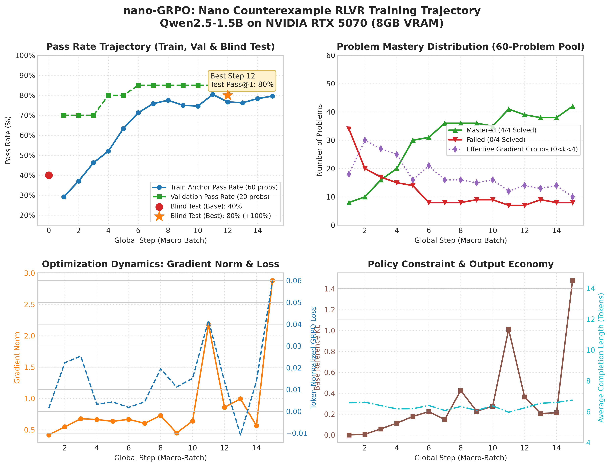

# nano-GRPO: Lightweight Verifiable RL (RLVR) with Macro-Batch GRPO

<div align="center">

[](https://opensource.org/licenses/MIT)
[](https://www.python.org/)
[](https://pytorch.org/)
[-green.svg)](https://www.nvidia.com/)
[](https://huggingface.co/Qwen/Qwen2.5-1.5B)
[-brightgreen.svg)](#)
[](https://mimo.xiaomi.com)

**面向消费级硬件（8GB VRAM）构建的高效可验证奖励强化学习（RLVR）与宏步梯度累积训练系统。**  
在程序差分测试（Differential Testing）与反例挖掘任务中，探索小参数语言模型（Qwen2.5-1.5B）如何通过纯强化学习自主掌握边界判定逻辑；在严格隔离的独立测试集上，贪心解通过率（Pass@1）实现从 **40.0% 到 80.0% 的翻倍提升**。

</div>

---

## 🏆 核心评测基准与实测结果 (Benchmark Results)

在完全隔离、训练及超参数调优阶段未见过的 **20 道独立测试集 (Blind Test Benchmark)** 上，非学习启发式基准、基座模型（Qwen2.5-1.5B Base）与 nano-GRPO 强化学习训练策略在 3 个独立随机种子（Seed 42, 43, 44）下的评测对比如下：

| 评测方法 / 模型策略 | 机制与采样预算 | 独立测试集 Pass@1 (Greedy) | 独立测试集 Pass@4 (Sampling) | 候选单点命中率 (Hit Rate) |
| :--- | :--- | :---: | :---: | :---: |
| **纯随机探测 (Random Search)** | 离散定义域均匀随机采样 | 5.0% (1/20) | 15.0% (3/20) | 6.25% (5/80) |
| **AST 常量优先启发式 (Literal-First)** | 静态解析提取代码常数 $c$，优先探测 $\{c \pm 1\}$ | 65.0% (13/20) | 95.0% (19/20) | 27.50% (22/80) |
| **基座模型 (Qwen2.5-1.5B Base)** | 零样本贪心 / 随机采样 ($T=0.7$) | 40.0% (8/20) | 60.0% (12/20) | 40.00% (8/20) |
| **nano-GRPO 策略 (Seed 42)** | 验证集选模最佳检查点 (Step 12) | 80.0% (16/20) | 85.0% (17/20) | 76.25% (61/80) |
| **nano-GRPO 策略 (Seed 43)** | 验证集选模最佳检查点 (Step 13) | 80.0% (16/20) | 85.0% (17/20) | 71.25% (57/80) |
| **nano-GRPO 策略 (Seed 44)** | 验证集选模最佳检查点 (Step 15) | 75.0% (15/20) | 85.0% (17/20) | 77.50% (62/80) |
| **nano-GRPO 综合表现 ($N=3$ 均值 $\pm$ 标准差)** | **3 轮独立训练综合统计** | **78.33% $\pm$ 2.89%** | **85.00% $\pm$ 0.00%** | **75.00% $\pm$ 3.31%** |

> **关键实验结论与学术分析**：
> 1. **反例稀疏性与纯随机失效**：反例在输入空间中高度稀疏（平均单点稀疏度 $\le 2\%$），纯随机搜索难以命中（Pass@4 仅 15.0%）；
> 2. **符号启发式 vs 神经网络**：AST 常量启发式具备直接读取抽象语法树常数节点的能力，在显式包含阈值（如 `x < 38`）的题目上表现优异；但大语言模型未接入任何 AST 外部工具，仅面对纯文本代码 token；
> 3. **稳健的强化学习提升**：通过纯 RLVR 宏步训练，1.5B 模型在 3 轮独立随机种子下均展现了高度一致的收敛行为，确定性贪心通过率从基座的 **40.0% 稳步倍增至 78.33% $\pm$ 2.89%**，采样 Pass@4 在所有种子上均稳定收敛至 **85.0% (17/20)**，证明模型习得了针对控制流差异的自适应边界聚焦能力，具备坚实的统计复现性。完整多轮实验记录详见 [multiseed_counterexample_report.json](file:///home/littlelei/github/nano-GRPO/reports/multiseed_counterexample_report.json)。

<div align="center">
  
</div>

*图注：基于 15 轮宏步（75 次优化器参数更新，累计 3,600 次探索采样）的训练动力学全景。左上：贪心通过率跃升轨迹；右上：全错（All-Zero）与全对（All-One）题目的剪刀差收敛；左下：损失收敛与平稳梯度范数；右下：受控参考策略 KL 漂移（维持在 0.05 散度阈值内）。*

---

## 🔬 交互式差分测试演示 (Interactive Differential Testing Demo)

执行交互脚本，可从独立测试集中抽选样例，直观比对基座策略与强化学习策略的执行结果：

```bash
python demo.py --num_cases 2
```

**控制台实测输出快照：**
```text
========================================================================
nano-GRPO: Program Differential Testing & Counterexample Mining Demo
Base Model: Qwen/Qwen2.5-1.5B | Device: cuda
RLVR Checkpoint: checkpoints_counterexample/20261014T102327Z-d1694cb8/checkpoint-best
========================================================================
[Model Init] Loading base model and LoRA adapter weights...
[Model Setup] Loading base tokenizer and model: Qwen/Qwen2.5-1.5B...
[Model Setup] Resuming LoRA adapter weights from checkpoint: .../checkpoint-best
trainable params: 9,232,384 || all params: 1,552,946,688 || trainable%: 0.5945
  [Memory Snapshot Post-Model-Init] Allocated: 2980.5 MB | Reserved: 3192.0 MB (Capacity: 8151 MB)
[Model Init] Base policy and RL adapter ready.

────────────────────────────────────────────────────────────────────────
[Case 1] Problem ID: cmp_lt_lte_26 | Tier: level_1
Specification: Check if x is strictly less than 38 vs at most 38.
Domain: [0, 50] | Counterexamples: [38] (Sparsity: 1.96%)
────────────────────────────────────────────────────────────────────────
【Program Pair Specification】:
  def f_a(x: int) -> bool:           │  def f_b(x: int) -> bool:
      return x < 38                  │      return x <= 38
────────────────────────────────────────────────────────────────────────
  Zero-Shot Base Policy                 │  RLVR Optimized Policy
  Raw: '39</input>'                     │  Raw: '38</input>'
  Parsed Input: x = 39                  │  Parsed Input: x = 38
  f_A(39) = False                       │  f_A(38) = False
  f_B(39) = False                       │  f_B(38) = True
  Verification: Outputs Match (0.0)     │  Verification: Divergence Confirmed (+1.0)
────────────────────────────────────────────────────────────────────────
[Case 2] Problem ID: cmp_gt_gte_36 | Tier: level_1
Specification: Check if x is strictly greater than 46 vs at least 46.
Domain: [0, 50] | Counterexamples: [46] (Sparsity: 1.96%)
────────────────────────────────────────────────────────────────────────
【Program Pair Specification】:
  def f_a(x: int) -> bool:           │  def f_b(x: int) -> bool:
      return x > 46                  │      return x >= 46
────────────────────────────────────────────────────────────────────────
  Zero-Shot Base Policy                 │  RLVR Optimized Policy
  Raw: '47</input>'                     │  Raw: '46</input>'
  Parsed Input: x = 47                  │  Parsed Input: x = 46
  f_A(47) = True                        │  f_A(46) = False
  f_B(47) = True                        │  f_B(46) = True
  Verification: Outputs Match (0.0)     │  Verification: Divergence Confirmed (+1.0)
========================================================================
```

---

## 🌟 任务建模与可验证奖励环境 (Verifiable RL Environment)

`bug_differential` 的返回值通过带类型标记的 JSON 传输，支持 `None`、布尔、整数、浮点、字符串、bytes，以及嵌套的 list、tuple、dict、set、frozenset。比较规则在所有嵌套层级严格区分类型，忽略字典和集合顺序；浮点使用 `rel_tol=abs_tol=1e-7`，NaN 与 NaN 视为等价，无穷值保留符号。自定义对象和超过 64 层的容器不在返回值契约内，序列化失败不会获得差分奖励。这些规则定义了本任务的正确性标准。

动态重采样强制与原策略同温，`--resample_temp_boost` 仅保留兼容值 `0.0`。日志中的 `initial_pass_rate` 统计初次采样，`anchor_pass_rate` 统计最终保留组，`overall_rollout_pass_rate` 统计全部尝试。`total_tokens_generated` 逐次累计所有候选的有效补全 token（含 EOS、不含 padding），`retained_tokens_generated` 只计最终用于更新的样本。成功筛选会改变训练样本分布，因此重采样属于实验功能；比较效率时应采用全部尝试的候选和 token 预算。

### 1. 为什么选择程序差分测试（Differential Testing）？
* **规避奖励作弊与模型幻觉**：自然语言推理任务易受 Reward Model 欺骗（Reward Hacking）。在差分测试环境中，真理完全由 Python 原生执行器裁决：给定程序对 $(f_A, f_B)$，判题系统直接验证 $f_A(x) \neq f_B(x)$，具备确定性与零幻觉特性。
* **规避预期值心算开销**：传统代码测试任务强制模型生成断言并自主推导预期输出（如 `assert f(x) == expected`），小模型容易因心算错误被惩罚。差分任务仅需模型定位边界输入 $x$，输出序列极短（8 ~ 32 tokens）。
* **可量化难度阶梯与反例稀疏度**：
  * **Level 1 (边界条件与单点偏差)**：比较运算符偏差（如 `x < c` vs `x <= c`），反例在离散域中高度稀疏（单点稀疏度约 1.96%）；
  * **Level 2 (区间裁剪与截断差异)**：区间端点与极值函数截断（如 `min(x, c)` vs `min(x, c + 1)`），稀疏度 3% ~ 10%；
  * **Level 3 (周期取模与分段逻辑)**：周期性取模偏移与多分支逻辑判断。

```
                       ┌────────────────────────────────────────┐
                       │   输入: 任务规格 Spec + 程序对 (f_A, f_B)  │
                       └───────────────────┬────────────────────┘
                                           │
                                           ▼
                       ┌────────────────────────────────────────┐
                       │   策略模型定位边界输入 (8~32 Tokens)       │
                       │   输出格式: <input>INTEGER</input>      │
                       └───────────────────┬────────────────────┘
                                           │
                                           ▼
                       ┌────────────────────────────────────────┐
                       │   确定性沙盒并行执行: f_A(x) 与 f_B(x)      │
                       └───────────────────┬────────────────────┘
                                           │
                     ┌─────────────────────┴─────────────────────┐
                     ▼                                           ▼
           [f_A(x) != f_B(x)]                          [f_A(x) == f_B(x)]
          命中差分反例 (Divergence)                    输出一致 (No Divergence)
               Reward = +1.0                               Reward = 0.0
```

---

## ⚡ 核心算法与系统架构

### 1. 组相对优势估计 (Group Relative Advantage Estimation)
针对单个输入 prompt，采样 $G$ 路候选回答，经沙盒执行获得标量奖励序列 $R = [R_1, \dots, R_G]$。组内标准化优势定义为：
$$A_i = \frac{R_i - \mu_R}{\sigma_R + \epsilon}$$
其中 $\mu_R = \frac{1}{G}\sum R_j$，$\sigma_R = \sqrt{\frac{1}{G}\sum (R_j - \mu_R)^2}$。  
**零方差过滤保护 (Zero-Variance Guard)**：当整组候选全对或全错时（$\sigma_R < 10^{-6}$），主动跳过策略梯度反传，避免无效梯度扰动。

### 2. 无偏基座参考策略 KL 正则化 (Schulman k3 Estimator)
使用 PEFT 动态禁用 LoRA 适配器（`disable_adapter()`）直接获取基座模型的真实参考对数概率 $\log \pi_{\mathrm{ref}}$，无需加载双份模型权重，显著节约显存。  
采用高精度非负 Schulman k3 近似估计器：
$$D_{\mathrm{KL}}^{\mathrm{approx}} = \frac{\exp(\Delta) - 1 - \Delta}{\tau^2}, \quad \Delta = \log \pi_\theta(y_t|x, y_{<t}) - \log \pi_{\mathrm{ref}}(y_t|x, y_{<t})$$
在 FP32 精度下通过 `torch.expm1` 计算，避免半精度浮点消减误差，确保策略优化不会脱离基座语言流利度约束。

### 3. 宏步梯度累积与子批次参数更新 (Macro-Batch Scheduling)
* **固定锚点池重锚定**：构建包含 60 道题目的固定训练集池（Anchor Pool）。每轮全局步（Global Step）前随机重排题目次序。
* **子批次增量更新**：设置 `problems_per_update=12`，将全池划分为 5 组子批次。在每个子批次内累积多题梯度后触发参数更新，兼顾高频参数更新与全题库探索覆盖。
* **严格 Token 级与题目级两级归一化**：
  $$\mathcal{L}_{\mathrm{update}} = \frac{1}{M} \sum_{m=1}^M \frac{\sum_{t} \mathcal{L}_{m, t} \cdot \mathrm{mask}_{m, t}}{\sum_{t} \mathrm{mask}_{m, t} + \epsilon}$$
  损失计算对显存微批次（`micro_batch_size`）划分严格不变。

---

## 📊 三相纯净数据集划分 (`tasks/data/counterexample_dataset.json`)

| 数据集分划 | 题目规模 | 采样配置 | 用途与隔离规范 |
| :--- | :---: | :---: | :--- |
| **Train 训练锚点池** | 60 题 | $G=4$ 探索候选 | 强化学习探索与策略梯度迭代。 |
| **Validation 验证集** | 20 题 | 确定性贪心解码 | 评估泛化进展，筛选并持久化 `checkpoint-best`。 |
| **Test 独立测试集** | 20 题 | 贪心 Pass@1 / 采样 Pass@4 | **全流程严格隔离**，零参与训练与超参选择，仅在训练结束执行最终无偏评测。 |

*注：三者题目 ID、程序对及特征参数交集严格为 0。*

---

## 💻 显存优化与硬件要求

本项目专为消费级硬件优化，在 **RTX 5070 Laptop GPU (8GB VRAM)** 环境下实测指标如下：

* **静态显存占用**：基座模型（Qwen2.5-1.5B, bfloat16）+ LoRA 适配器约 **2980 MB**。
* **动态峰值显存**：并发生成（$G=4$）、KV Cache、参考模型前向与反向传播峰值显存占用为 **3379 MB**（低于 4.2 GB 显存安全水位）。
* **单轮耗时**：全套 15 轮宏步（3,600 次推理生成与 75 次优化器更新）耗时约 **20 分钟**。

---

## ⚡ 快速开始与复现

### 1. 环境准备
```bash
# 激活 Conda 环境并安装依赖
conda create -n nano-grpo python=3.11 -y
conda activate nano-grpo
pip install -r requirements.txt
```

### 2. 运行单元测试套件
```bash
# 运行涵盖算法损失、梯度累积、两级归一化、动态重采样与差分判题的完整回归测试 (59 项测试)
python -m unittest discover tests/ -v
```

### 3. 启动强化学习训练

```bash
# 模式一: 推荐——Nano Counterexample 宏步强化学习训练 (15 轮宏步，75 次参数更新)
python train_mimo.py --task counterexample --global_steps 15 --problems_per_update 12 --lr 2e-5

# 模式二: 在线流式微步探索 (每题立即更新优化器)
python train.py --task counterexample --total_steps 100 --lr 2e-5

# 模式三: 差分缺陷审计拓展任务 (方向 C: 输入差分执行，沙盒真值判题)
python train_mimo.py --task bug_differential --global_steps 15 --problems_per_update 12

# 模式四: 跨任务适配器热启动迁移 (方向 B: 加载 Counterexample 权重微调)
python train_mimo.py --task bug_differential --init_adapter checkpoints_counterexample/<run-id>/checkpoint-best

# 断点恢复与精确续训 (自动校验超参、恢复优化器动量与 RNG 随机状态)
python train_mimo.py --resume_checkpoint ./checkpoints_counterexample/<run-id>/checkpoint-last --global_steps 25
```

### 4. 运行交互式对比演示
```bash
# 查看独立测试集上的前瞻对比
python demo.py --num_cases 3
```

---

## 📂 模块化代码库结构

```text
nano-GRPO/
├── trainer/
│   ├── mimo_engine.py         # 宏步梯度累积强化学习引擎 (Macro-Batch RLVR)
│   ├── engine.py              # 在线流式 GRPO 训练引擎 (Online Streaming)
│   ├── grpo_loss.py           # GRPO 目标函数、无偏基座 KL 与两级 Token 归一化
│   ├── utils.py               # 显存守护、LoRA 挂载、状态持久化与恢复
│   ├── experiment.py          # 实验生命周期、配置校验与断点恢复管理器
│   ├── evaluation.py          # 评测协议 (Greedy Pass@1 与 采样 Pass@k)
│   └── run.py                 # 统一执行流程调度
├── tasks/
│   ├── counterexample.py      # 主线任务: 差分程序反例挖掘环境与三级难度合成器
│   ├── bug_differential.py    # 扩展任务: 基于输入差分执行的程序缺陷审计轨道 (方向 C)
│   ├── semantic_values.py     # 类型安全的跨进程对象序列化与深度值判等器
│   ├── counterexample_2d.py   # 2D 几何边界与高维反例扩展生成器
│   ├── bug_hunter.py          # 挑战任务: 变异代码反例审计与双向沙盒执行器
│   ├── base.py                # Task 抽象协议
│   └── data/
│       ├── counterexample_dataset.json  # 差分测试三相基准题库 (Train 60, Val 20, Test 20)
│       └── bug_hunter_dataset.json      # BugHunter 三相代码审计题库
├── assets/
│   └── training_curves.png    # 300 DPI 出版级 4 栏训练动力学曲线图
├── scripts/
│   ├── plot_metrics.py        # 训练全景曲线自动生成脚本
│   ├── benchmark_multimetric.py # 多维度指标离线批量评估工具
│   ├── evaluate_differential_transfer.py # 差分缺陷审计基线与迁移零样本评测
│   └── evaluate_counterexample_baselines.py # 随机与 AST 常量启发式基准评测
├── tests/
│   ├── test_counterexample.py       # 反例生成与启发式单测
│   ├── test_counterexample_2d.py    # 2D 几何高维反例单测
│   ├── test_bug_differential.py     # 输入差分判题与类型序列化单测
│   ├── test_dynamic_resampling.py   # 动态零方差重采样同温对齐单测
│   ├── test_init_adapter.py         # 跨任务迁移适配器初始化单测
│   ├── test_overhaul.py             # 核心算法与沙盒回归单测
│   └── test_review_regressions.py   # 续训断点与分批更新单测
├── demo.py                    # 终端交互式双模对抗演示脚本
├── train_mimo.py              # 宏步强化学习主入口
├── train.py                   # 流式微步强化学习主入口
└── requirements.txt           # 项目依赖清单
```

---

## 🙏 灵感来源 (Acknowledgments & Citations)

本项目在算法架构与工程设计过程中，深度吸收了以下前沿技术报告与学术成果的思想：

1. **Xiaomi MiMo 训练范式**：本项目的宏步调度架构（Macro-Batch Scheduling）与固定锚点题库迭代机制，灵感源自小米大模型团队在强化学习推理中的工程实践（[Xiaomi MiMo](https://mimo.xiaomi.com)），将单题即时更新升级为跨题库的子批次梯度累积更新，大幅提升了小参数模型策略梯度的信噪比。
2. **DeepSeek-Math & DeepSeek-R1**：组相对策略优化（GRPO）算法框架、无偏基座参考策略 KL 散度近似估计器（Schulman k3 形式）以及可验证奖励强化学习（RLVR）原则。
3. **Dr. GRPO**：关于显存微批次切分下 Token 级归一化对累积梯度的数学不变性推导。

---

## 📄 开源许可证 (License)

本项目采用 [MIT License](./LICENSE) 开源。欢迎学术探讨与技术交流！
