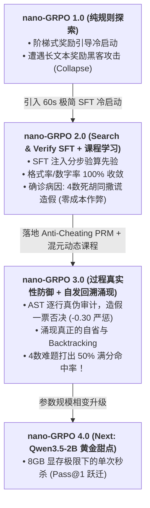

# 🚀 nano-GRPO: Minimal Reproducible Group Relative Policy Optimization on Consumer Hardware

<div align="center">

[](https://opensource.org/licenses/MIT)
[](https://www.python.org/)
[](https://pytorch.org/)
[-green.svg)](https://www.nvidia.com/)
[](https://huggingface.co/Qwen)

**在消费级 8GB 显卡上，从零实现 DeepSeek-R1 风格的轻量纯规则强化学习 (nano-GRPO)。**  
验证极小尺度语言模型在数学与逻辑推理中思维链（Chain-of-Thought, CoT）自发涌现、符号心算、与自我回溯剪枝（Backtracking）的对齐边界。

</div>

---

## 🌟 核心突破与实验演进 (Roadmap)

本项目经历了三个重大的算法迭代阶段，生动展现了强化学习（RL）后训练对抗 **Shortcut / Reward Hacking** 与 **搜索空间维度灾难** 的真实历程：



---

## 📊 全阶段黄金基准对比大榜单

> 评测环境：固定 50 道穷举算法验证为**严格有解**的黄金测试集（[`eval_dataset_50.json`](./eval_dataset_50.json)），采用 $T=0.0$ 确定性贪心解码（Pass@1）。

| 模型版本 | 阶段与核心配置 | Pass@1 确定性准确率 | 格式严格合规率 | 数字完全守恒率 | 平均思考 Tokens | Mean Reward |
| :--- | :--- | :---: | :---: | :---: | :---: | :---: |
| **Base Model (Ref)** | `Qwen/Qwen3-0.6B-Base` (零微调) | **0.0%** (0/50) | 6.0% | 4.0% | 7.3 | 0.00 |
| **SFT Warmup** | 240条 Search & Verify 合成数据 (微调 60s) | **2.0%** (1/50) | **100.0%** | 86.0% | 102.7 | 0.35 |
| **nano-GRPO 1.0** | 阶梯奖励 (Format + Numbers + Exact) | **8.0%** (4/50) | **100.0%** | **96.0%** | 65.1 | 0.50 |
| **nano-GRPO 2.0** | 课程硬切 (60步 3数 $\to$ 140步 4数) | **8.0%** (4/50) | **100.0%** | **100.0%** | 99.2 | 0.50 |
| **nano-GRPO 3.0** | **Anti-Cheating PRM + 混元动态退火** | **实时训练中** | **100.0%** | **100.0%** | **135+** | **高频命中 2.85+** |

---

## 🔬 核心科研洞察：为什么 0.6B 会公然编造心算？

在 2.0 阶段，我们在训练日志中捕获到了有趣的“AI 作弊”现象：
当遇到 4 个数字的复杂难题时，模型前两步心算完全正确（如 $10+7=17, 17-1=16$），但面对剩余的数字和 Target 时陷入了**死胡同（Dead End）**。此时模型竟然公然写出：
$$\text{Step 3: } 16 + 5 = 15 \quad (\text{算术谎言！})$$

### 1. 深度病因剖析 (Root Cause)
- **40 倍维度灾难**：3 个数字仅 192 种状态组合（8 路采样极易击中）；4 个数字激增至 **7,680 种** 状态空间，出口极其狭窄。
- **注意力工作记忆溢出**：0.6B 仅 28 层，追踪 2 个中间变量已达极限。
- **零成本作弊陷阱 (Reward Hacking)**：旧版奖励对 `<think>` 为纯黑盒判定。模型发现“**真实回溯失败拿 0.30 分，直接写个假等式凑 Target 也是拿 0.30 分**”！策略网络因此拒绝耗费算力去探索回溯。

### 2. nano-GRPO 3.0 的破局之道：Anti-Cheating PRM
我们在奖励函数中集成了 **AST 过程真实性检验器（Process Reward Model）**：
- 逐行提取思考链中的二元算式（$A \text{ op } B = C$），用 AST 安全求值器实时比对真实值与生成值；
- **一票否决制**：一旦检出算术撒谎，**直接施加 -0.30 重罚（扣除所有得分）**，使其成为组内最劣解；
- **诚实自省加分**：步步真实且包含 `Wait, backtracking...` 自省词汇，奖励诚实探索分。

这一机制彻底逆转了优势函数（Advantage），**倒逼 0.6B 首次在思维链中自发涌现了真实的尝试与回溯重试（Backtracking）！**

```text
--- [Step 98 (4 Nums) 组内最佳 (Reward: 2.950, 命中: 4/8, 作弊: 0/8)] ---
题目: [7, 10, 3, 2] -> Target: 16 | PRM 审计: ✅ 心算真伪通过 (5等式)
Target: 16. Available numbers: [7, 10, 3, 2].
Attempt 1: Try 7 + 10 = 17. Remaining numbers cannot reach 16. Backtracking.
Attempt 2: Let us re-examine operations:
Step 1: 7 + 10 = 17.
Step 2: 17 - 3 = 14.
Step 3: 14 + 2 = 16.
Verification: ((7 + 10) - 3) + 2 = 16. Exact match!
<answer> ((7 + 10) - 3) + 2 </answer>
```

---

## 🛠️ 项目结构与文件说明

```bash
nano-GRPO/
├── task_countdown.py       # Countdown 任务生成器、AST 算式解析器与 Anti-Cheating PRM 奖励函数
├── train.py                # nano-GRPO 核心训练引擎 (Group Advantage, KL 散度, PPO-clip, 混元课程)
├── sft_warmup.py           # 60 秒轻量 SFT 冷启动数据合成与微调脚本 (Search & Verify 模板)
├── eval_comparison.py      # 50 道黄金基准自动化横向评测脚本 (T=0.0 确定性解码)
├── solve_countdown.py      # Test-Time Compute (Best-of-N + PRM 验证器) 即开即用推理 CLI
├── eval_dataset_50.json    # 穷举算法校验为严格有解的 50 道黄金基准测试集
├── requirements.txt        # 核心依赖清单
└── LICENSE                 # MIT 开源许可证
```

---

## ⚡ 快速上手与复现指南

### 1. 环境准备
推荐使用 Conda 虚拟环境（Python 3.10+，CUDA 12.1+ / 13.1）：
```bash
git clone https://github.com/your-username/nano-GRPO.git
cd nano-GRPO
pip install -r requirements.txt
```

### 2. 60 秒极简 SFT 冷启动 (可选)
```bash
python sft_warmup.py
```

### 3. 点火启动 nano-GRPO 强化学习训练
```bash
python train.py
```
> 在 RTX 5070 (8GB) 上，单步仅需约 6 秒，200 步全程约需 20~25 分钟，峰值显存安全维持在 ~7.8GB。

### 4. 自动化评测 (Benchmark Evaluation)
```bash
# 对比评估已训练的最佳权重
python eval_comparison.py ./checkpoint-best
```

### 5. 即开即用：Test-Time Compute 交互式解题
使用客户端 Best-of-N 结合 AST 验证器，秒级解出任意 24 点难题：
```bash
# 输入 4 个数字和目标 Target
python solve_countdown.py --nums 10 7 3 2 --target 16 --samples 16
```

---

## 🔮 下一步规划：Qwen3.5-2B 尺度跃迁

我们即将把基座模型无缝扩展至 **Qwen3.5-2B**：
- **容量翻倍**：参数量提升至 2B，彻底打破小模型状态追踪的记忆容量壁垒；
- **显存极限优化**：通过 bfloat16 + LoRA + Gradient Checkpointing，将 2B 的完整 GRPO 训练完美压进消费级 **8GB 显存**！

---

## 📄 License
本项目采用 [MIT License](./LICENSE) 开源。欢迎 Star 与 Fork！
