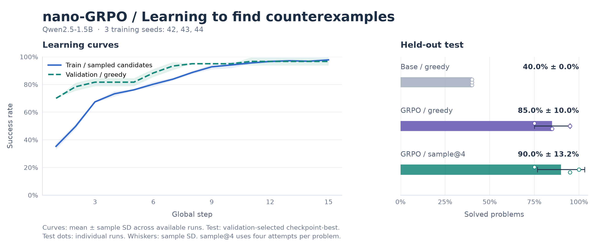
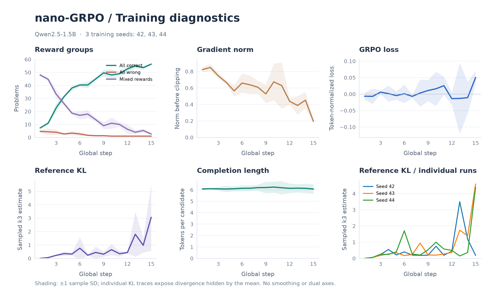
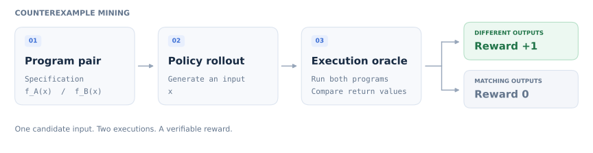

<div align="center">

# ⚡ nano-GRPO

**Minimal, Reproducible RLVR for Program Differential Testing & Counterexample Mining**  
*用 Qwen2.5-1.5B 与 GRPO 从零训练“代码边界反例挖掘”*

[](./LICENSE)
[](https://www.python.org/)
[](https://pytorch.org/)
[](https://huggingface.co/Qwen/Qwen2.5-1.5B)
[](#hardware)

**[🇨🇳 中文说明](./README.md) | [🇬🇧 English Documentation](./README_en.md)**

[核心结果](#results) · [快速开始](#quickstart) · [交互演示](#demo) · [任务与可验证奖励](#tasks) · [GRPO 核心实现](#algorithm) · [硬件开销](#hardware) · [项目结构](#structure)

</div>

---

## 🎯 项目简介

在软件测试中，两个看似等价的程序往往只在极少数的**边界条件（Corner Cases）** 下产生行为分歧（例如 `<` 与 `<=` 的 Off-by-one 误差、开闭区间端点、分段阈值或极值截断）。

**`nano-GRPO`** 是一个面向单张消费级显卡（8GB VRAM，峰值仅需 **~3.4 GB**）的可验证奖励强化学习（RLVR, Reinforcement Learning with Verifiable Rewards）实战项目：
- **输入**：两个行为高度相似的 Python 函数 `f_a(x)` 与 `f_b(x)`；
- **输出**：一个能触发两者返回值差异的反例输入 `x`（使得 `f_a(x) != f_b(x)`）；
- **奖励**：无需人类标注或过程打分模型，直接由确定性代码执行沙箱实时判题（触发差异奖励 `+1.0`，否则 `0.0`）。

在 `Qwen2.5-1.5B` 基座上，经过 **15 个 MiMo 宏步（75 次参数更新，单种子约 30 分钟）** 的 GRPO 强化训练，测试集 **Greedy Pass@1** 从基座的 **40.0%** 提升至 **85.00% ± 10.00%**，**Sample Pass@4** 从 **55.00% ± 5.00%** 提升至 **90.00% ± 13.23%**（三个独立随机种子 `42 / 43 / 44`，按验证集选模）。

---

<a id="results"></a>
## 📊 实验结果

主线实验使用 60 道训练题、20 道验证题和 20 道独立测试题。训练种子为 `42`、`43`、`44`，每次训练 15 个宏步（共 75 次梯度更新，`group_size=8`，开启动态重采样 `max_resample_rounds=3`）。各次运行严格依据验证集 Greedy 分数选择 `checkpoint-best`（平局保留最早一步），最后在固定的 20 道测试题上进行统一评测。

### 1. GRPO 训练前后对比（Test Split, 20 题）

| 模型 / 训练种子 | 验证集最佳宏步（验证集分数） | 测试 Greedy Pass@1 | 测试 Sample Pass@4 | 采样候选命中率 (Hit Density) |
| :--- | :---: | :---: | :---: | :---: |
| **Qwen2.5-1.5B Base** | — | 40.0%（8/20） | 55.00% ± 5.00% | 30.00% ± 3.31% |
| **GRPO · Seed 42** | Step 8（95%） | 85.0%（17/20） | 95.0%（19/20） | 78.75%（63/80） |
| **GRPO · Seed 43** | Step 11（100%） | 95.0%（19/20） | 100.0%（20/20） | 92.50%（74/80） |
| **GRPO · Seed 44** | Step 7（95%） | 75.0%（15/20） | 75.0%（15/20） | 70.00%（56/80） |
| **GRPO 均值 ± 样本标准差** | — | **85.00% ± 10.00%** | **90.00% ± 13.23%** | **80.42% ± 11.34%** |

- **Greedy Pass@1**：每题确定性贪心解码 1 次，统计触发 `f_a(x) != f_b(x)` 的题数占比。
- **Sample Pass@4**：每题以 `temperature=0.7` 采样 4 个候选输入，至少 1 个触发差异即算解题成功。
- **采样候选命中率**：80 个采样候选中有效反例的总占比。
- 完整报告见 [`reports/multiseed_counterexample_report.json`](./reports/multiseed_counterexample_report.json)。

> [!NOTE]
> **方差与局限**：种子间差异较大。验证集只有 20 题，从 Step 7 起多步并列 95%，按“最早一步”规则 Seed 44 选到了尚未收敛的 Step 7（测试 75%）。作为参考，三个种子的最终 `checkpoint-last` 测试 Greedy 均为 90%、Sample Pass@4 为 96.67% ± 2.89%，但它不是按验证集选出的，不作为主结果。测试集为固定的 20 题，样本量小，结论应谨慎解读。

### 2. 与非学习启发式基线对比

为了客观衡量小模型到底学到了多少边界直觉，项目内置了两种传统测试启发式基线（详见 [`reports/counterexample_baselines_report.json`](./reports/counterexample_baselines_report.json)）：

| 方法 | 单次预算 (Budget=1) | 四次预算 (Budget=4) | 候选命中密度 (80 次采样) |
| :--- | :---: | :---: | :---: |
| **纯随机定义域采样 (Random Search)** | 5.0%（1/20） | 15.0%（3/20） | 6.25%（5/80） |
| **AST 常量邻域探测 (Constant + Neighbors)** | 65.0%（13/20） | **95.0%（19/20）** | 27.50%（22/80） |
| **GRPO 训练策略 (Qwen2.5-1.5B)** | **85.00% ± 10.00%** | 90.00% ± 13.23% | **80.42% ± 11.34%** |

> [!TIP]
> **实验洞察**：
> - **单次直觉 (Pass@1)**：AST 启发式按固定顺序枚举 `c, c-1, c+1`，单次成功率 **65.0%**；GRPO 训练的 1.5B 模型结合算符方向直接给出边界，单次贪心平均 **85.00%**。
> - **四次枚举 vs 候选精度**：4 次尝试下 AST 启发式达到 **95.0%**，仍高于 GRPO 的 90.00% 均值，但其候选命中密度只有 **27.50%**；GRPO 每次采样的命中率为 **80.42%**。



*左图：训练集候选命中率与验证集 Greedy Pass@1 随宏步的演进曲线（阴影为 3 个种子的 ±1 样本标准差）。右图：验证集选出的 `checkpoint-best` 在独立测试集上的最终表现。*

<details>
<summary>🔍 <strong>点击展开：六维训练诊断图（有效梯度组、GradNorm、GRPO Loss、KL 散度与生成长度）</strong></summary>



*各指标独立使用纵轴；右下角单独绘出每个训练种子的 Schulman k3 KL 轨迹，避免均值曲线掩盖单次运行波动。所有曲线均直接绘自原始 `metrics.jsonl`，未做人为平滑。*

</details>

---

<a id="quickstart"></a>
## 🚀 快速开始

### 1. 安装环境与运行单元测试

```bash
git clone https://github.com/littlelei0103/nano-GRPO.git
cd nano-GRPO

conda create -n nano-grpo python=3.11 -y
conda activate nano-grpo
pip install -r requirements.txt

# 运行完整回归测试套件（59 项测试，涵盖 GRPO 数学性质、沙箱安全、断点精确恢复与差分判题）
python -m unittest discover -s tests -v
```

### 2. 一键启动 MiMo 宏步 GRPO 训练

```bash
python train_mimo.py \
  --task counterexample \
  --global_steps 15 \
  --anchor_size 60 \
  --problems_per_update 12 \
  --group_size 8 \
  --micro_batch_size 4 \
  --max_new_tokens 16 \
  --lr 3e-5 \
  --kl_coef 0.01 \
  --temperature 0.7 \
  --dynamic_resampling \
  --max_resample_rounds 3 \
  --seed 42
```

每个全局宏步遍历全部 60 道训练题，打乱后每 12 道题执行一次梯度累积与参数更新（每宏步 5 次更新，15 宏步共 75 次更新）。检查点与日志自动保存在 `checkpoints_counterexample/<run-id>/`。

### 3. 断点精确续训与图表重绘

```bash
# 精确恢复模型权重、优化器动量、学习率进度与 CPU/CUDA RNG 状态
TASK_RUN_DIR="checkpoints_counterexample/替换为实际run-id"
python train_mimo.py \
  --task counterexample \
  --resume_checkpoint "$TASK_RUN_DIR/checkpoint-last" \
  --global_steps 25 \
  --seed 42

# 从实验日志一键重新生成论文级 PNG + SVG 曲线图
python scripts/plot_metrics.py
```

---

<a id="demo"></a>
## 🎮 交互式终端演示 (`demo.py`)

训练完成后（或使用已有的 `checkpoints_counterexample/`），运行 [`demo.py`](./demo.py) 可以直观对比 **Zero-Shot Base 模型** 与 **RLVR 训练后模型** 在测试集边界题上的表现：

```bash
# 默认抽取 3 道跨越不同难度层级的代表性测试题进行双栏对比
python demo.py --num_cases 3

# 额外加入 Level 4 二元几何边界 (2D) 挑战题演示
python demo.py --num_cases 3 --include_2d
```

<details>
<summary>📺 <strong>点击展开：终端双栏对抗演示实录</strong></summary>

```text
========================================================================
nano-GRPO: Program Differential Testing & Counterexample Mining Demo
Base Model: Qwen/Qwen2.5-1.5B | Device: cuda
RLVR Checkpoint: checkpoints_counterexample/20261027T180108Z-c068a69d/checkpoint-best
========================================================================
────────────────────────────────────────────────────────────────────────
[Case 1] Problem ID: cmp_lt_lte_26 | Tier: level_1
Specification: Check if x is strictly less than 38 vs at most 38.
Domain: [0, 50] | Counterexamples: [38] (Sparsity: 1.96%)
────────────────────────────────────────────────────────────────────────
【Program Pair Specification】:
  def f_a(x: int) -> bool:           │  def f_b(x: int) -> bool:
      return x < 38                  │      return x <= 38
────────────────────────────────────────────────────────────────────────
  Zero-Shot Base Policy                 │  RLVR Optimized Policy
  Raw: '39</input>'                     │  Raw: '38</input>'
  Parsed Input: 39                      │  Parsed Input: 38
  f_A(39)          = False              │  f_A(38)          = False
  f_B(39)          = False              │  f_B(38)          = True
  Verification: Outputs Match (0.0)     │  Verification: Divergence Confirmed (+1.0)
────────────────────────────────────────────────────────────────────────
[Case 2] Problem ID: interval_right_open_30 | Tier: level_2
Specification: Interval inclusion: [33, 42] vs [33, 42).
Domain: [0, 50] | Counterexamples: [42] (Sparsity: 1.96%)
────────────────────────────────────────────────────────────────────────
【Program Pair Specification】:
  def f_a(x: int) -> bool:           │  def f_b(x: int) -> bool:
      return 33 <= x <= 42           │      return 33 <= x < 42
────────────────────────────────────────────────────────────────────────
  Zero-Shot Base Policy                 │  RLVR Optimized Policy
  Raw: '33</input>'                     │  Raw: '42</input>'
  Parsed Input: 33                      │  Parsed Input: 42
  f_A(33)          = True               │  f_A(42)          = True
  f_B(33)          = True               │  f_B(42)          = False
  Verification: Outputs Match (0.0)     │  Verification: Divergence Confirmed (+1.0)
────────────────────────────────────────────────────────────────────────
[Case 3] Problem ID: clamp_abs_min_clip_33 | Tier: level_2
Specification: Upper bound clamp using min(x, 25) vs min(x, 26).
Domain: [0, 50] | Counterexamples: [26, 27, 28, 29, 30, 31] (Sparsity: 49.02%)
────────────────────────────────────────────────────────────────────────
【Program Pair Specification】:
  def f_a(x: int) -> int:            │  def f_b(x: int) -> int:
      return min(x, 25)              │      return min(x, 26)
────────────────────────────────────────────────────────────────────────
  Zero-Shot Base Policy                 │  RLVR Optimized Policy
  Raw: '25</input>'                     │  Raw: '50</input>'
  Parsed Input: 25                      │  Parsed Input: 50
  f_A(25)          = 25                 │  f_A(50)          = 25
  f_B(25)          = 25                 │  f_B(50)          = 26
  Verification: Outputs Match (0.0)     │  Verification: Divergence Confirmed (+1.0)

========================================================================
📊 Demo Scoreboard (3 Cases Evaluated)
  • Zero-Shot Base Policy  : 0/3 (0.0%)
  • RLVR Optimized Policy  : 3/3 (100.0%)
========================================================================
```

</details>

---

<a id="tasks"></a>
## 🧩 任务体系与可验证奖励

### 1. 主线任务：`counterexample`（程序差分反例挖掘）

给定程序对 `(f_a, f_b)`，模型预测 `<input>INTEGER</input>`。数据合成器离线穷举定义域 `[0, 50]`，确保每道题都存在真实反例并精确记录反例稀疏度（Sparsity）：

| 难度分级 | 缺陷模式与算术边界特征 | 反例稀疏度示例 |
| :--- | :--- | :--- |
| **Level 1 (`comparison`)** | 比较算符 Off-by-one 边界（`<` vs `<=`、`>` vs `>=`） | `1/51 (1.96%)` 单点针尖反例 |
| **Level 2 (`interval` / `clamping_abs`)** | 双端开闭区间端点、`min/max` 极值截断、绝对值邻域半径 | `1.96% ~ 49.02%` |
| **Level 3 (`piecewise_arithmetic`)** | 三路符号分支激活、分段线性倍率、周期取模相位偏移 | `1.96% ~ 33.33%` |
| **Level 4 (`2D Multi-Variable`，可选)** | 二元输入 `(x, y)`：曼哈顿距离菱形边界、线性半平面、二维包围盒 | 2D 网格边界点集 |



### 2. 扩展代码验证任务

除主线任务外，`tasks/` 目录还实现了三个递进复杂度任务，共享同一套 GRPO 训练管线：
- **`bug_differential`**（[`tasks/bug_differential.py`](./tasks/bug_differential.py)）：阅读函数规格与缺陷实现，输出触发 Golden 与 Buggy 差异的多类型参数字面量（支持嵌套容器、浮点数容差 `1e-7` 与类型严格对齐）。
- **`bug_hunter`**（[`tasks/bug_hunter.py`](./tasks/bug_hunter.py)）：生成完整的 `assert target_func(...) == expected` 单元测试断言，同时考察前置条件合法性、预期输出计算与缺陷触发。
- **`code_exec`**（[`tasks/code_exec.py`](./tasks/code_exec.py)）：根据规格编写 Python 函数，在隔离的受限沙箱进程 [`tasks/code_worker.py`](./tasks/code_worker.py) 中抵御符号篡改与超时攻击并运行单元测试。

---

<a id="algorithm"></a>
## 🧠 GRPO 核心工程实现

代码位于 [`trainer/grpo_loss.py`](./trainer/grpo_loss.py) 与 [`trainer/mimo_engine.py`](./trainer/mimo_engine.py)，重点解决了小显存单卡 RLVR 训练中的多项数值与统计细节：

### 1. 组内相对优势 (Group Relative Advantage)
对每道题并发采样 $G$ 条候选轨迹，根据执行器返回的客观奖励计算标准化优势：

$$A_i = \frac{R_i - \mu_R}{s_R + \epsilon}, \qquad \mu_R = \frac{1}{G}\sum_{j=1}^{G}R_j, \qquad s_R = \sqrt{\frac{1}{G-1}\sum_{j=1}^{G}(R_j-\mu_R)^2}$$

### 2. 零额外权重的基座 KL 约束与 FP32 `expm1` 抗消减
- **零显存冗余参考模型**：通过 PEFT 的 `with model.disable_adapter():` 动态切换回冻结基座计算 $\log \pi_{\mathrm{ref}}$，无需在显存中加载第二份 1.5B 权重。
- **全支撑集温度对齐**：严格禁止 `top_p < 1.0` 或 `top_k > 0` 截断支撑集，并且采样、当前策略和参考策略均除以同一温度 $T$，确保重要性比率与 Schulman $k_3$ KL 估计无偏。
- **消除 BF16 灾难性消减**：当策略接近基座时，$\Delta_t = \log \pi_{\mathrm{ref}}(y_t\mid h_t) - \log \pi_\theta(y_t\mid h_t) \to 0$。实现中强制在 FP32 下使用 `torch.expm1(d) - d` 计算 $k_{3,t} = e^{\Delta_t} - 1 - \Delta_t$。

### 3. 微批次梯度等价性（两级 Token 归一化）
在显存受限时，单题的 $G$ 个候选可拆分为多个 `micro_batch_size` 依次前向与反传。损失先除以**整道题全部有效生成 token 总数**，再除以当前子批次题目数 $M$，从数学上保证**任意改变 `micro_batch_size` 所得梯度与一次性整批反传完全一致**：

$$\mathcal{L}_{\mathrm{update}} = \frac{1}{M}\sum_{q=1}^{M} \frac{\sum_{i=1}^{G}\sum_t m_{q,i,t}\,\ell_{q,i,t}}{\sum_{i=1}^{G}\sum_t m_{q,i,t}+\epsilon}$$

### 4. 全零组梯度保护与边界邻近度塑形 (Boundary Proximity Shaping)
- **全零组反向传播跳过保护**：当组内奖励标准差 $s_R < 10^{-6}$ 时直接跳过反向传播，避免在全错组上仅反传参考策略 KL 导致模型被拉回基座的错误先验。
- **全零盲区题边界引导**：针对全错组（`solved_in_group == 0`），计算合法输入到真实反例集合的距离分 $r_{\text{prox}} = \text{round}(0.2 / (1 + d_{\min}), 4) < 0.2$，在不改变二值解题统计口径的前提下为近似边界猜测（如 `26` 逼近 `27`）提供方向梯度。
- **余弦学习率衰减**：第 5 个宏步后启用余弦学习率衰减至 $0.25 \times \text{lr}$，抑制后期 KL 散度剧烈膨胀。

---

<a id="hardware"></a>
## 💻 硬件占用与训练耗时

以下为 `Qwen2.5-1.5B`（BF16 + LoRA + Gradient Checkpointing）在单张 **NVIDIA RTX 5070 Laptop GPU (8GB VRAM)** 上的实测数据：

| 指标项目 | 实测数值 |
| :--- | :--- |
| **模型与 LoRA 加载后显存** | ~2,980 MiB |
| **GRPO 训练峰值 Allocated 显存** | **~3,483 MiB (~3.5 GB)** |
| **主线训练配置** | `group_size=8`, `micro_batch_size=4`, `max_new_tokens=16`, `dynamic_resampling=True` |
| **单次完整实验耗时 (15 宏步 / 75 次更新)** | **约 28~30 分钟** |

---

<a id="structure"></a>
## 📂 项目目录结构

```text
nano-GRPO/
├── trainer/                 # GRPO 核心引擎、损失函数、评测与状态恢复
│   ├── grpo_loss.py         # Completion-only LogProb、FP32 k3 KL 与 PPO-Clip 损失
│   ├── mimo_engine.py       # MiMo 宏步子批次引擎 + 动态零方差重采样
│   ├── engine.py            # 单题流式 GRPO 训练引擎
│   ├── evaluation.py        # 验证集与测试集统一解码评测器
│   ├── experiment.py        # 数据/判题器 SHA256 指纹校验与检查点优选
│   ├── utils.py             # LoRA 挂载、原子化检查点保存与 RNG 恢复
│   └── run.py               # 统一训练生命周期入口
├── tasks/                   # 可验证奖励任务集与安全执行沙箱
│   ├── counterexample.py    # 主线：程序差分反例挖掘（含 1D/2D 合成器与启发式基线）
│   ├── bug_differential.py  # 扩展：无断言多类型差分测试
│   ├── bug_hunter.py        # 扩展：单元测试断言合成
│   ├── code_exec.py         # 扩展：受限沙箱代码生成
│   ├── code_worker.py       # 进程级隔离执行器（防御内建篡改与死循环）
│   └── data/                # 固定划分的数据集 JSON
├── scripts/                 # 多种子报告汇总、启发式基线评测与科研绘图脚本
├── tests/                   # 59 项单元与回归测试
├── reports/                 # 多种子实验与基线评测 JSON 报告
├── assets/                  # 训练曲线、诊断图与任务流程图 (PNG & SVG)
├── demo.py                  # 双栏终端交互式对比演示脚本
├── train_mimo.py            # 宏步训练主入口
├── train.py                 # 流式训练入口
└── README_en.md             # 英文版完整文档
```

---

## 🔗 致谢与姊妹项目

- **算法参考**：[DeepSeekMath (GRPO)](https://arxiv.org/abs/2402.03300) · [DeepSeek-R1 (RLVR)](https://arxiv.org/abs/2501.12948) · [Xiaomi MiMo](https://mimo.xiaomi.com)
- **姊妹项目**：
  - 🔄 [**nano-CodeSelfPlay**](https://github.com/littlelei0103/nano-CodeSelfPlay)：无需人工缺陷题对，单基座双 LoRA（Mutator 出题者 vs. Breaker 找茬者）对抗代码自博弈。
  - 🟩 [**WordleZero**](https://github.com/littlelei0103/WordleZero)：1.5B 小模型的多轮 Wordle 信息论博弈与两阶段 R1-GRPO 强化学习竞技场。

## 📄 许可证

本项目采用 [MIT License](./LICENSE) 开源。
