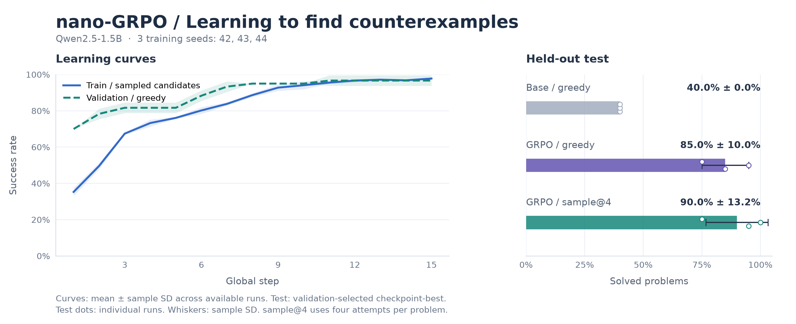
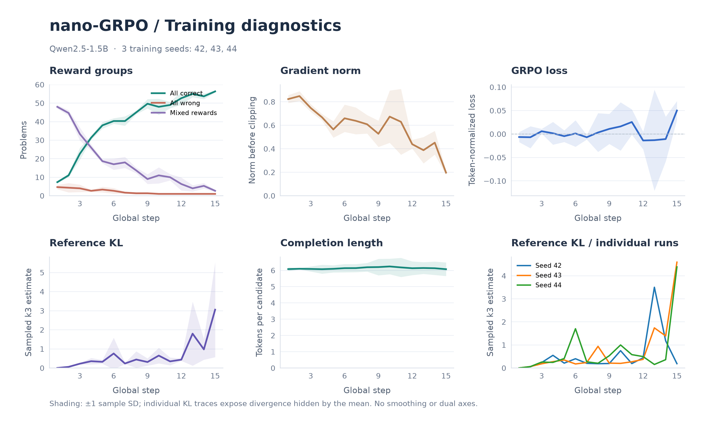

<div align="center">

# ⚡ nano-GRPO

**Minimal, Reproducible RLVR for Program Differential Testing & Counterexample Mining**  
*Training a 1.5B LLM to hunt boundary counterexamples with Group Relative Policy Optimization*

[](./LICENSE)
[](https://www.python.org/)
[](https://pytorch.org/)
[](https://huggingface.co/Qwen/Qwen2.5-1.5B)
[](#hardware)
[](./tests)

**[🇨🇳 中文说明](./README.md) | [🇬🇧 English Documentation](./README_en.md)**

[Results](#results) · [Quick Start](#quickstart) · [Interactive Demo](#demo) · [Tasks & Verifiable Rewards](#tasks) · [GRPO Implementation](#algorithm) · [Hardware](#hardware) · [Structure](#structure)

</div>

---

## 🎯 Overview

In software testing, two seemingly equivalent functions often diverge only on sharp **boundary inputs (corner cases)**—such as `<` vs. `<=` off-by-one thresholds, open/closed interval endpoints, piecewise branching, or clamping limits.

**`nano-GRPO`** is a clean, hackable, single-GPU (~3.4 GB peak VRAM) **Reinforcement Learning with Verifiable Rewards (RLVR)** repository built on `Qwen2.5-1.5B`:
- **Input**: Two short Python functions `f_a(x)` and `f_b(x)` over a bounded integer domain;
- **Output**: A counterexample input `x` where `f_a(x) != f_b(x)`;
- **Verifiable Reward**: Direct, deterministic execution in a restricted Python sandbox (`+1.0` if return values diverge, `0.0` otherwise—zero reward hacking or judge hallucination).

Across three independent training seeds (`42 / 43 / 44`), 15 macro-steps of GRPO training (~30 minutes per seed on a laptop GPU) lift held-out test **Greedy Pass@1** from **40.0%** to **85.00% ± 10.00%**, and **Sample Pass@4** from **55.00% ± 5.00%** to **90.00% ± 13.23%** (checkpoints selected on validation).

---

<a id="results"></a>
## 📊 Experimental Results

The benchmark uses 60 training problems, 20 validation problems, and 20 held-out test problems. Each seed (`42, 43, 44`) trains for 15 macro-steps (75 parameter updates, `group_size=8`, dynamic resampling with `max_resample_rounds=3`) and selects `checkpoint-best` strictly by validation Greedy accuracy (earliest step on ties) before evaluating on the 20 test problems.

### 1. Base vs. GRPO Policy (Held-Out Test Split, 20 Problems)

| Model / Training Seed | Best Macro-Step (Val) | Test Greedy Pass@1 | Test Sample Pass@4 | Candidate Hit Density |
| :--- | :---: | :---: | :---: | :---: |
| **Qwen2.5-1.5B Base** | — | 40.0% (8/20) | 55.00% ± 5.00% | 30.00% ± 3.31% |
| **GRPO · Seed 42** | Step 8 (95%) | 85.0% (17/20) | 95.0% (19/20) | 78.75% (63/80) |
| **GRPO · Seed 43** | Step 11 (100%) | 95.0% (19/20) | 100.0% (20/20) | 92.50% (74/80) |
| **GRPO · Seed 44** | Step 7 (95%) | 75.0% (15/20) | 75.0% (15/20) | 70.00% (56/80) |
| **GRPO Mean ± Sample SD** | — | **85.00% ± 10.00%** | **90.00% ± 13.23%** | **80.42% ± 11.34%** |

- **Greedy Pass@1**: One deterministic decode per problem.
- **Sample Pass@4**: Four sampled candidates (`temperature=0.7`) per problem; solved if at least one exposes `f_a(x) != f_b(x)`.
- **Candidate Hit Density**: Fraction of all 80 sampled candidates that are valid counterexamples.
- Full JSON report: [`reports/multiseed_counterexample_report.json`](./reports/multiseed_counterexample_report.json).

> [!NOTE]
> **Variance and limitations**: Seed-to-seed variance is large. With only 20 validation problems, many steps tie at 95% from step 7 onward, and the earliest-tie rule selects an unconverged step 7 for seed 44 (75% test). For reference, the final `checkpoint-last` of all three seeds scores 90% Greedy and 96.67% ± 2.89% Sample Pass@4 on test, but it is not validation-selected and is not reported as the main result. The 20-problem test set is small; interpret conclusions cautiously.

### 2. Comparison with Non-Learning Heuristics

We also compare against classical non-learning test generators ([`reports/counterexample_baselines_report.json`](./reports/counterexample_baselines_report.json)):

| Method | 1-Attempt Pass Rate | 4-Attempt Pass Rate | Candidate Hit Density (80 draws) |
| :--- | :---: | :---: | :---: |
| **Uniform Random Search** | 5.0% (1/20) | 15.0% (3/20) | 6.25% (5/80) |
| **AST Constant + Neighbor Prober** | 65.0% (13/20) | **95.0% (19/20)** | 27.50% (22/80) |
| **GRPO Trained Policy (Qwen2.5-1.5B)** | **85.00% ± 10.00%** | 90.00% ± 13.23% | **80.42% ± 11.34%** |

> [!TIP]
> **Key Takeaway**:
> - **Single-Shot Precision (Pass@1)**: The AST heuristic enumerates `{c, c-1, c+1}` in fixed order (65.0% on attempt 1), while the GRPO-trained 1.5B model reads the operator direction and goes to the boundary directly (**85.00%** mean Greedy Pass@1).
> - **4-Attempt Coverage vs. Density**: With 4 deterministic probes the AST heuristic reaches 95.0%, still above GRPO's 90.00% mean, but at only 27.50% hit density versus **80.42%** for GRPO samples.



<details>
<summary>🔍 <strong>Expand 6-Panel Training Diagnostics (Reward Groups, Grad Norm, Loss, Reference KL, Length)</strong></summary>



</details>

---

<a id="quickstart"></a>
## 🚀 Quick Start

### 1. Installation & Unit Tests

```bash
git clone https://github.com/littlelei0103/nano-GRPO.git
cd nano-GRPO

conda create -n nano-grpo python=3.11 -y
conda activate nano-grpo
pip install -r requirements.txt

# Run the 59-test regression suite
python -m unittest discover -s tests -v
```

### 2. Train the Counterexample Policy (MiMo Macro-Step Engine)

```bash
python train_mimo.py \
  --task counterexample \
  --global_steps 15 \
  --anchor_size 60 \
  --problems_per_update 12 \
  --group_size 8 \
  --micro_batch_size 4 \
  --max_new_tokens 16 \
  --lr 3e-5 \
  --kl_coef 0.01 \
  --temperature 0.7 \
  --dynamic_resampling \
  --max_resample_rounds 3 \
  --seed 42
```

### 3. Interactive Side-by-Side Demo (`demo.py`)

```bash
# Compare Zero-Shot Base vs. RLVR Policy on held-out test problems
python demo.py --num_cases 3

# Include a 2D multi-variable geometric boundary problem (Level 4)
python demo.py --num_cases 3 --include_2d
```

---

<a id="algorithm"></a>
## 🧠 Core Engineering Highlights

Implemented in [`trainer/grpo_loss.py`](./trainer/grpo_loss.py) and [`trainer/mimo_engine.py`](./trainer/mimo_engine.py):
1. **Zero-Copy Reference KL via PEFT `disable_adapter()`**: Computes $\log \pi_{\mathrm{ref}}$ without loading a second 1.5B model into VRAM.
2. **FP32 `torch.expm1` Schulman $k_3$ KL Estimator**: Eliminates BF16 catastrophic cancellation when $\pi_\theta \approx \pi_{\mathrm{ref}}$.
3. **Full-Support Temperature Calibration**: Enforces `top_p=1.0, top_k=0` and divides rollout, policy, and reference logits by the exact same temperature $T$.
4. **Micro-Batch Invariant Two-Level Normalization**: Normalizes token loss by total active completion tokens across the group $G$ and averages across the sub-batch size $M$, guaranteeing identical gradients regardless of `micro_batch_size`.
5. **All-Zero Group KL Guard & Boundary Proximity Shaping**: Skips reference-KL-only backpropagation on zero-variance groups and injects a bounded proximity signal $r_{\text{prox}} = \text{round}(0.2 / (1 + d_{\min}), 4) < 0.2$ when `solved_in_group == 0`, breaking single-point off-by-one deadlocks while preserving binary pass-rate accounting.

---

<a id="hardware"></a>
## 💻 Hardware Footprint

Measured on an **NVIDIA RTX 5070 Laptop GPU (8GB VRAM)** with `Qwen2.5-1.5B` (BF16 + LoRA + Gradient Checkpointing):
- **Post-Load VRAM**: ~2,980 MiB
- **Peak Training Allocated VRAM**: **~3,483 MiB (~3.5 GB)**
- **Wall-Clock Time (15 macro-steps / 75 updates, `group_size=8` + dynamic resampling)**: **~28–30 minutes**

---

## 🔗 Sister Projects

- 🔄 [**nano-CodeSelfPlay**](https://github.com/littlelei0103/nano-CodeSelfPlay): Dual-LoRA adversarial code self-play (`Mutator` bug injector vs. `Breaker` counterexample hunter) from zero human bug pairs.
- 🟩 [**WordleZero**](https://github.com/littlelei0103/WordleZero): 1.5B multi-turn Wordle arena comparing information-theoretic solvers and two-stage R1-GRPO agents.

## 📄 License

Released under the [MIT License](./LICENSE).
